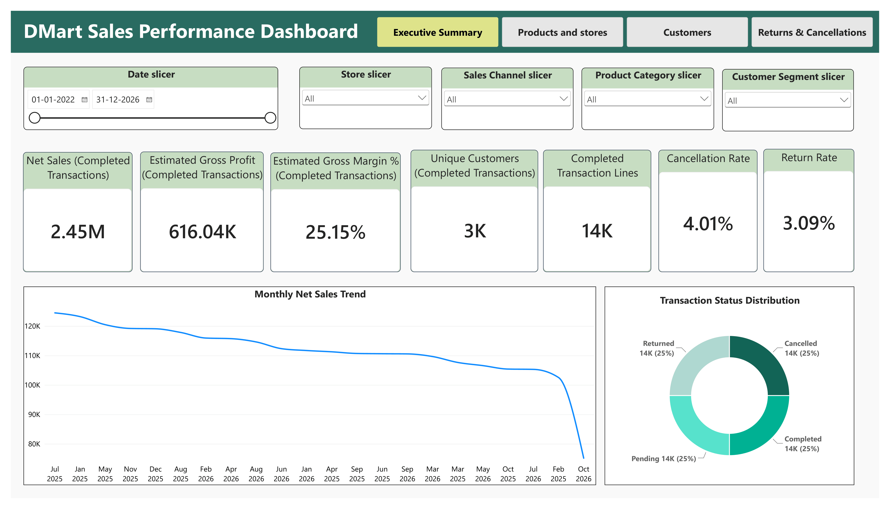
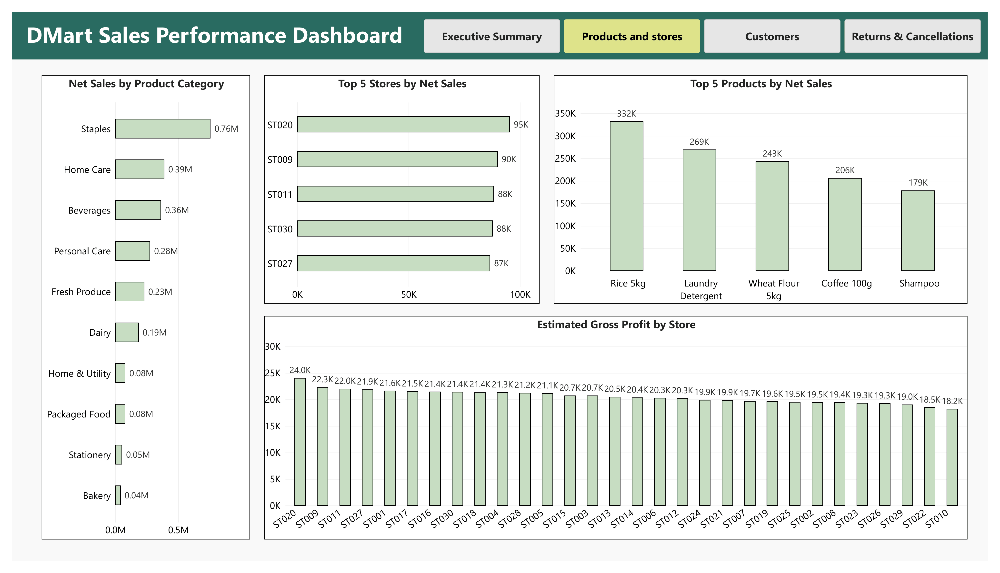
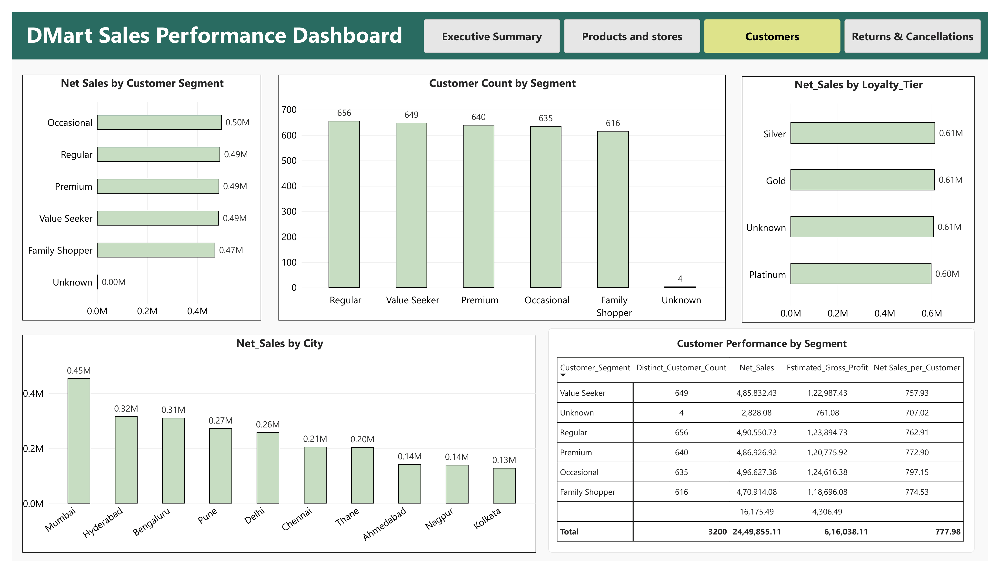
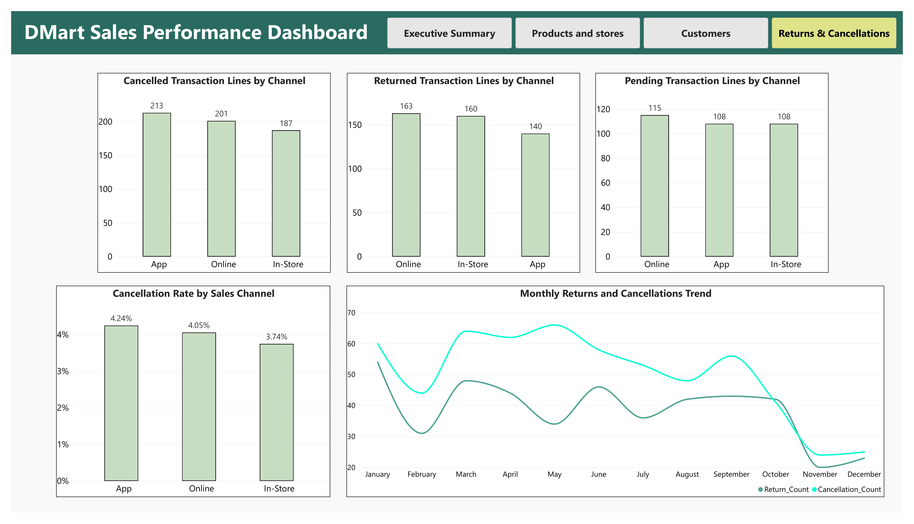

# DMart Sales Performance Dashboard

An end-to-end data analytics portfolio project using **Python (Pandas)** for data cleaning and validation and **Power BI** for KPI reporting, interactive analysis, and business recommendations.

> **Dataset note:** The dataset used in this project is synthetic. It does not contain real customer data and is used for study and portfolio purposes only. The findings and recommendations describe patterns in this synthetic dataset, not actual DMart business performance.

## Dashboard Preview

The dashboard has five pages: Executive Summary, Products & Stores, Customers, Returns & Cancellations, and Data Quality. Small previews are available below; expand the section only if you want to view them.

<details>
<summary>View dashboard screenshots</summary>

**Executive Summary**



**Products & Stores**



**Customers**



**Returns & Cancellations**



</details>

## Project Objectives

- Clean and standardize transaction, customer, and product data.
- Validate data quality and relationships between the datasets.
- Calculate sales, discount, customer, and estimated profitability KPIs.
- Build an interactive Power BI report to analyze performance by month, product category, store, sales channel, and customer group.
- Identify actionable opportunities and document assumptions and limitations.

## Tools & Technologies

- **Python** — data cleaning and validation
- **Pandas and NumPy** — data manipulation
- **Jupyter Notebook** — documented analysis workflow
- **Microsoft Power BI** — data model and interactive dashboard
- **DAX** — KPI measures
- **CSV** — source and cleaned datasets

## Repository Structure

```text
.
├── README.md
├── dashboard/
│   ├── DMart_Sales_Performance_Dashboard.pbix
│   └── DMart_Sales_Performance_Dashboard.pdf
├── data/
│   ├── raw/
│   │   ├── Dmart_Consumer_Transactions_Raw.csv
│   │   ├── Dmart_Customer_Master_Raw.csv
│   │   └── Dmart_Product_Lookup.csv
│   └── clean/
│       ├── transactions_clean.csv
│       ├── customers_clean.csv
│       └── products_clean.csv
├── notebook/
│   └── Dmart_Project.ipynb
└── screenshots/
    ├── Executive_Summary.png
    ├── Products_and_Stores.png
    ├── Customers.png
    └── Returns_and_Cancellations.png
```

## Data Scope

| Dataset | Rows received | Rows used / retained |
|---|---:|---:|
| Consumer transactions | 15,035 | 14,990 |
| Customer master | 3,226 | 3,200 |
| Product lookup | 20 | 20 |

- **Period covered:** 1 January 2025 to 19 October 2026.
- **Stores:** 30.
- **Products:** 20 across 10 categories.
- **Sales channels:** App, Online, and In-Store.
- **Row-level definition:** Each `Transaction_ID` represents a product line, not a full bill or basket. A bill number is not available in the dataset.

## Data Cleaning & Validation

The Jupyter Notebook documents the cleaning and preparation workflow, including:

- Removing 10 duplicate transaction rows and 26 duplicate customer rows.
- Removing 35 transaction rows with missing or invalid dates.
- Keeping 80 transaction rows with a missing `Customer_ID` by assigning `Unknown`; these can be used for appropriate sales analysis but are excluded from known-customer analysis.
- Converting 13 negative completed quantities and 12 negative unit prices to positive values, as they were treated as entry errors.
- Setting 10 discount values above 100% to blank and excluding those lines from net sales and profit calculations.
- Standardizing inconsistent text values and date formats.
- Setting 10 invalid customer ages to blank.
- Checking links between transactions, customers, and products, including transactions dated before recorded signup dates.

Derived transaction fields include gross sales, discount amount, net sales, estimated cost, estimated gross profit, month, year, and a `Valid_Row` flag.

## Key Results

The report's financial KPIs use **Completed transaction lines only**.

| KPI | Result |
|---|---:|
| Gross sales | ₹25,89,458 |
| Total discount | ₹1,37,945 (5.3% of gross sales) |
| Net sales | ₹24,49,855 |
| Estimated gross profit | ₹6,16,038 |
| Estimated gross margin | 25.1% |
| Average discount rate | 5.33% |
| Completed transaction lines | 13,595 |
| Units sold | 20,507 |
| Average line value | ₹180 |
| Unique known customers with a completed line | 3,149 |
| Revenue per unique customer | ₹778 |

### Transaction status summary

| Status | Lines | Share of all lines | Value |
|---|---:|---:|---:|
| Cancelled | 601 | 4.0% | ₹1,13,665 |
| Returned | 463 | 3.1% | ₹82,261 |
| Pending | 331 | 2.2% | ₹66,758 |

Completed, cancelled, returned, and pending lines reconcile to **14,990 total cleaned transaction lines**. The status values shown above are separate from completed-sales KPIs.

## Key Insights

- **Sales declined slightly year over year:** January–September 2026 net sales were 2.6% lower than January–September 2025 (₹10.02 lakh versus ₹10.29 lakh). October 2026 is partial and is excluded from full-period trend comparisons.
- **Deeper discounts were associated with lower margins without higher units per line:** gross margin fell from 29.1% with no discount to 11.5% at a 20% discount, while average units per line remained around 1.5.
- **Staples contribute the largest sales share but have lower margins:** Staples generated ₹7,55,560, or 30.8% of net sales, at a 19.2% estimated gross margin.
- **Rice 5kg is a major low-margin product:** it represented 13.6% of sales and had a 16.7% estimated gross margin.
- **Cancelled, returned, and pending lines need attention:** together they represent 9.3% of all lines and ₹2,62,684 in value. 87% of pending lines were older than 90 days.
- **Customer spend was similar across groups:** spend per customer ranged from ₹757 to ₹797 across customer segments, while spend by loyalty tier was also very similar.
- **Store performance is relatively distributed:** all 30 stores contributed between 2.9% and 3.9% of net sales. Store and category exceptions are useful investigation leads, not proof of underlying causes.

## Recommendations

1. Test a routine discount cap of 10% in selected stores and monitor margin and units per line.
2. Improve margins on Staples, starting with Rice and Sunflower Oil.
3. Increase visibility of high-margin categories through shelf placement and bundles.
4. Clear the aged pending backlog and introduce a defined ageing and escalation rule.
5. Review cancellation and return patterns at stores ST003 and ST007 and within Fresh Produce.
6. Test targeted loyalty offers instead of assuming loyalty tiers increase spend.
7. Improve future data capture by adding a bill number, return reason, and store-level cost information.

These are recommendations based on patterns in the synthetic data. Estimated impacts are assumptions for testing, not guaranteed outcomes.

## Dashboard Pages

- **Executive Summary:** KPI cards, monthly net sales trend, and slicers for date, store, channel, category, and segment.
- **Products & Stores:** Net sales by category and top stores.
- **Customers:** Net sales by customer segment, loyalty tier, and city.
- **Returns & Cancellations:** Cancelled, returned, and pending transaction lines by sales channel.

## How to Explore the Project

1. Open `dashboard/DMart_Sales_Performance_Dashboard.pdf` to review the exported report.
2. Open `dashboard/DMart_Sales_Performance_Dashboard.pbix` in Microsoft Power BI Desktop to interact with the dashboard.
3. Review `notebook/Dmart_Project.ipynb` for cleaning steps, derived fields, and validation checks.
4. Compare the source CSVs in `data/raw/` with the prepared datasets in `data/clean/`.

**Notebook note:** The notebook uses local Windows file paths in its import/export cells. If you want to rerun it on another computer, update those paths to match your project location.

## Assumptions & Limitations

- **Synthetic data:** No real customer data is included. The project is for study and portfolio purposes.
- **Estimated profit:** Estimated gross profit uses the provided unit cost per product. Store operating costs, wastage, staffing, and other expenses are not included.
- **No bill number:** Average line value is reported instead of basket value.
- **Returns:** Returned lines are not linked to their original sale in the supplied data.
- **Signup-date issue:** 2,674 transactions (17.8%) occurred before the recorded customer signup date. These rows were counted and reported rather than removed; signup date is not used for tenure or cohort analysis.
- **Preferred store:** Only 3.6% of transactions matched the customer's preferred store, so this field is not used to infer store loyalty.
- **Partial month:** October 2026 covers only 1–19 October and is excluded from like-for-like growth and full-month trend comparisons.
- **Interpretation:** Store, channel, and segment differences are small; no statistical tests were run. Observed patterns should not be treated as causal findings.

## Skills Demonstrated

- Data cleaning and preprocessing
- Exploratory data analysis
- Data-quality checks and relational validation
- KPI calculation and business metric definitions
- Power BI data modeling and dashboard development
- DAX measures
- Business insights, recommendations, and transparent documentation of limitations
